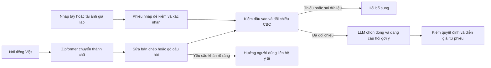

# AI SPEC — Giải thích 8 chỉ số CBC thai kỳ · Nhóm 4thangtay · Lớp L3B · Zone [Chờ BTC]

> Mốc nộp: §7 chốt chuẩn "đạt" tại **CP2 19:30 Thứ Sáu 27/11** · §0–§7 nộp **CP3 10:00 Thứ Bảy 28/11** · đủ §0–§10 **CP4 14:30 Thứ Bảy 28/11** · §10 changelog ghi tiếp đến **23:59 Thứ Bảy 28/11**.
> Đầu mỗi mục ghi bước guide (`02-guide.md` trong repo đề) chỉ cách điền. Mỗi mục ngắn, có số và nguồn; chi tiết để ở file được trỏ tới. Xoá dòng hướng dẫn trong ngoặc vuông khi điền xong.

Track: [ ] A · [ ] B · [ ] C · [ ] D · [ ] E · [x] F — bài toán: Hỗ trợ thai phụ Việt Nam trưởng thành (TCN1–3) tự đọc hiểu và chuẩn bị câu hỏi cho bác sĩ từ phiếu kết quả 8 chỉ số CBC trọng tâm (`HGB`, `RBC`, `HCT`, `MCV`, `MCH`, `MCHC`, `WBC`, `PLT`)
Data BTC cấp đã dùng (nếu có — không commit nguyên file): Không dùng data BTC cấp; nhóm dùng số liệu công bố *Pham et al. (2023)* tại BV Hùng Vương (workbook `.xlsx` gốc giữ ngoài repo công khai), hướng dẫn WHO (2024), BV Từ Dũ và MedlinePlus.

## §0. Hiện tại việc này diễn ra thế nào *(guide 1.1)*
- Luồng hiện tại của việc này, tại phòng khám hoặc khi tự xem phiếu (4 bước):
  1. Thai phụ lấy máu xét nghiệm tổng phân tích tế bào máu (CBC) trong lịch khám thai định kỳ (từ TCN1 theo lịch BV Từ Dũ, trung bình 8–12 lần khám cả thai kỳ).
  2. Phòng xét nghiệm trả phiếu giấy hoặc kết quả điện tử, trong đó nhiều máy tự động in sẵn khoảng tham chiếu của người trưởng thành không mang thai (`HGB 12.0–15.5 g/dL`, `WBC 4.0–10.0 × 10^9/L`) và đánh dấu `L`/`H` hoặc in đậm các chỉ số lệch khỏi khoảng đó.
  3. Khi chưa kịp hỏi bác sĩ hoặc mang phiếu về nhà xem lại, thai phụ gặp các ký hiệu viết tắt tiếng Anh (`HGB`, `HCT`, `MCV`, `MCH`, `MCHC`, `WBC`, `PLT`) cùng đơn vị khác nhau (`g/L` vs `g/dL`, `%` vs `L/L`), nên tự tìm kiếm trên Google, hỏi trong hội nhóm thai kỳ hoặc nhắn người quen để đoán mức độ nghiêm trọng.
  4. Thai phụ chờ 1–4 tuần tới buổi tái khám tiếp theo mới hỏi bác sĩ, nhưng thường quên chi tiết muốn hỏi hoặc đã tự mua thêm viên sắt bổ sung.
- Công cụ / AI đang được dùng cho việc này (nếu có) + nguồn: Máy xét nghiệm in sẵn khoảng tham chiếu người không mang thai (nêu trong *Pham et al., 2023* và *MedlinePlus* về rủi ro tự dùng khoảng tham chiếu khác phòng lab/đối tượng); công cụ tra cứu phổ biến là Google Search, hội nhóm mạng xã hội, hỏi đáp công khai; thói quen cụ thể của từng thai phụ `[Chờ xác nhận qua phỏng vấn P1–P3]`.

## §1. Người dùng & bằng chứng *(guide 1.1, 1.2)*
- Người dùng chính (một vai cụ thể): Thai phụ Việt Nam trưởng thành (mang thai ở tam cá nguyệt 1, 2 hoặc 3) tự đọc phiếu kết quả CBC trước hoặc sau buổi khám thai định kỳ.
- Việc họ cố làm xong (`động từ + đối tượng + bối cảnh`, không có chữ AI): Đọc hiểu ý nghĩa các chỉ số và dấu bất thường trên phiếu tổng phân tích tế bào máu (CBC) theo đúng tuần thai để chuẩn bị câu hỏi trao đổi với bác sĩ sản khoa.
- Hôm nay họ giải bằng gì, hỏng ở đâu, vì sao chưa bỏ: Tự tra Google từng chỉ số riêng lẻ, hỏi hội nhóm mẹ bầu hoặc chờ đến buổi tái khám tiếp theo. Cách này hỏng ở chỗ: kết quả tìm kiếm thường dùng khoảng tham chiếu của người không mang thai hoặc lệch đơn vị `g/L` so với `g/dL`, không phân biệt thay đổi sinh lý thai kỳ với ngưỡng cần khám, và dễ nhận lời khuyên tự ý tăng liều sắt. Họ chưa bỏ vì chưa có tài liệu đối chiếu nhanh theo từng tam cá nguyệt ngay tại thời điểm cầm phiếu, trong khi lịch khám định kỳ cách nhau 1–4 tuần.
- Pain (KHÔNG chữ AI): Thai phụ Việt Nam ở tam cá nguyệt 1–3 khi tự đọc phiếu 8 chỉ số CBC thường thấy các chỉ số như `HGB`, `HCT`, `MCV`, `MCHC`, `WBC` hoặc `PLT` bị đánh dấu bất thường do phiếu in khoảng tham chiếu người không mang thai và thiếu giải thích đơn vị theo tuần thai, khiến họ hoang mang, tốn thời gian tra cứu rời rạc và dễ tự bổ sung sắt sai hoặc bỏ sót câu hỏi cần trao đổi với bác sĩ sản khoa.
- Bằng chứng — số chính + kết luận (chi tiết: `evidence/summary.md`): Đào dữ liệu nghiên cứu BV Hùng Vương (*Pham et al., 2023*, `N = 837` panel CBC đủ) cho thấy **`416/837 (49.70%)`** thai phụ khỏe mạnh có `HGB < 12.0 g/dL` (bị gắn cờ thiếu máu sai nếu dùng ngưỡng nữ không mang thai) và **`95/837 (11.35%)`** nằm dưới ngưỡng sàng lọc thai kỳ WHO 2024 (`22/287 = 7.67%` TCN1, `28/273 = 10.26%` TCN2, `45/277 = 16.25%` TCN3) dù phần lớn thuộc khoảng sinh lý 2.5th–97.5th. Phần phỏng vấn người dùng `P1–P3` và kết luận cuối hiện ở trạng thái `[Chờ phỏng vấn P1–P3]`.

## §2. Impact & quyết định chọn *(guide 1.3)*

| Hướng | Bao nhiêu người gặp | Bao nhiêu lần / tháng | Mỗi lần tốn gì | Impact / tháng | Làm kịp không | Chọn? |
|---|---|---|---|---|---|---|
| **Hướng B · Giải thích 8 chỉ số CBC thai kỳ (TCN1–3, chế độ `lab`/`study`) + cổng từ chối ngoài phạm vi** *(danh mục nền đối chiếu tới 24 mã)* | `49.70%` (`416/837`) thai phụ khỏe có `HGB < 12.0 g/dL` (*Pham et al. 2023*); ước tính `~100.000` thai phụ tự đọc phiếu/tháng *(tự ước tính)* | `1.5` lần/tháng *(tự ước tính từ lịch khám Từ Dũ 8–12 lần/9 tháng)* | `15` phút/lần tra cứu + lo lắng oan *(tự ước tính; chờ kiểm qua P1–P3)* | `2.250.000` phút/tháng (~`37.500` giờ/tháng) *(tự ước tính)* | Kịp (Workflow cố định + bảng `reference_data.py` + bước xác nhận phiếu) | **Chọn** |
| **Hướng A · Giải thích CBC cho người lớn không mang thai (từ chối thai kỳ)** | Nhóm khám tổng quát không mang thai *(thiếu bộ dữ liệu RI Việt Nam chuẩn trên DxH 900)* | `0.3` lần/tháng *(tự ước tính)* | `10` phút/lần *(tự ước tính)* | Không định lượng được từ dữ liệu bệnh viện đã có | Kịp nhưng yếu bằng chứng R1/R4 | **Loại** |
| **Hướng C · Tự động chẩn đoán nguyên nhân bệnh lý & tư vấn liều sắt/thuốc từ ảnh phiếu không qua xác nhận** | Thai phụ có chỉ số lệch muốn hỏi thuốc uống ngay | `0.5` lần/tháng *(tự ước tính)* | `20` phút/lần *(tự ước tính)* | Rủi ro đọc sai ảnh chưa xác nhận và sai lệch điều trị y khoa rất cao | Không an toàn / ngoài thẩm quyền Track B | **Loại** |

- **Impact / tháng** của hướng chọn = `100.000` người *(tự ước tính quy mô thai phụ tự xem phiếu toàn quốc)* × `1.5` lần/tháng *(tự ước tính theo lịch khám thai định kỳ BV Từ Dũ 8–12 lần/thai kỳ)* × `15` phút/lần *(tự ước tính, chờ đối chiếu số phút thật sau phỏng vấn P1–P3)* = **`2.250.000` phút/tháng** (tương đương `22.5` phút/người/tháng; tỷ lệ nền `416/837 = 49.70%` thai phụ khỏe có `HGB < 12.0 g/dL` lấy từ nguồn *Pham et al., 2023*).
- Hướng ĐÃ LOẠI + vì sao (giữ lại, đừng xoá):
  - **Hướng A (người trưởng thành không mang thai):** Loại vì không có sẵn dữ liệu RI chuẩn người Việt trên máy DxH 900 cho người không mang thai và bỏ qua đúng nút thắt lớn nhất của bộ dữ liệu BV Hùng Vương (`49.70%` sai ngưỡng thai kỳ); tuy nhiên vẫn giữ toàn bộ cổng kiểm tra ngữ cảnh và từ chối ngoài phạm vi của Hướng A đưa vào Hướng B.
  - **Hướng C (tự động chẩn đoán bệnh lý & kê liều sắt/thuốc không qua xác nhận):** Loại vì chỉ từ CBC không thể chẩn đoán xác định thiếu sắt hay Thalassemia và việc gợi ý thuốc/liều uống vi phạm quy tắc an toàn Track B, đồng thời đọc ảnh không qua bước người dùng kiểm nhận dễ sai số thập phân hoặc đơn vị.
- Số lần / tháng của từng kiểu người dùng (dùng cho persona ở §8):
  - Thai phụ khám thai định kỳ tự xem phiếu CBC cơ bản (TCN1–3): `1–2 lần/tháng` *(tự ước tính theo lịch BV Từ Dũ, chờ kiểm qua P1–P3)*.
  - Thai phụ theo dõi thiếu máu / sát biên WHO (được hẹn xét nghiệm lại): `2–4 lần/tháng` *(tự ước tính)*.
  - Người ngoài phạm vi hỏi thử (không mang thai, nam giới, `> 65` tuổi — bị cổng từ chối): `1 lần/tháng` *(tự ước tính)*.

## §3. Giải pháp tương tự *(guide 2.1)*
- [sản phẩm / tính năng gần giống]: một điều đáng học · một điều đáng né · mình khác gì

## §4. Thiết kế *(guide 2.2, 3.2)*

Một thai phụ trưởng thành muốn hiểu dấu cao hoặc thấp trên phiếu CBC, AI chọn dòng liên quan để giải thích dựa trên dữ liệu đã xác nhận và gợi ý một câu hỏi cho buổi khám.

**Phạm vi** gồm đủ 21 chỉ số CBC và 3 chỉ số đông máu PT, APTT, FIB có trong bộ dữ liệu. Danh mục nằm ở `codebase/catalog.py`. Nhập tay hoặc đọc ảnh JPG/PNG vào các ô, người dùng kiểm tra và xác nhận, rồi hệ thống đối chiếu toàn bộ phiếu và trả bảng kết quả. Các yêu cầu chẩn đoán, điều trị hoặc kê thuốc được chuyển về nhân viên y tế. Khoảng tham chiếu lấy từ phiếu đã xác nhận, còn dữ liệu nghiên cứu dùng làm tài liệu tham khảo.

**Hình dạng.** Workflow cố định. Quy tắc đối chiếu và định dạng kết quả có các bước xác định, do đó một lời gọi model để chọn cách trả lời là đủ.

| Công cụ | Input | Output | Tác động ra ngoài |
|---|---|---|---|
| `compare_cbc` | Phiếu CBC đã xác nhận | Trạng thái từng dòng, hoặc trường cần sửa | Chỉ đọc |
| `transcribe_wav` | WAV PCM mono 16-bit | Câu hỏi dạng văn bản có thể sửa | Xử lý cục bộ |

**Mức tự động.** AI gợi ý, người dùng quyết định dùng thông tin nào để trao đổi với bác sĩ. Giao diện cho sửa số, đơn vị, khoảng và bản chép trước khi gửi.

**Chặn rủi ro.** Quy tắc yêu cầu đúng ngữ cảnh thai kỳ, định dạng số và đơn vị. Khi model chọn một dòng, hệ thống kiểm dòng đó có trên phiếu và chỉ hiển thị số đã đối chiếu. Yêu cầu khẩn rõ ràng được xử lý trước bước kiểm phiếu.

| Nguyên tắc | Chỗ áp dụng |
|---|---|
| G9 · Sửa dễ dàng | Sửa dữ liệu đọc từ ảnh và bản chép lời nói trước khi gửi |
| G10 · Thu hẹp phạm vi khi nghi ngờ | Hỏi lại khi thiếu dữ liệu, sai đơn vị hoặc model trả lựa chọn không hợp lệ |
| G11 · Giải thích vì sao | Hiển thị giá trị đối chiếu và hai giới hạn lấy từ phiếu |

**CP2.** Phiếu mẫu là giả lập. CLI có chế độ AI giả ghi nhãn rõ và có đường gọi Ollama. Giao diện đọc ảnh và ghi âm thuộc phần tích hợp.

## §5. Chỗ khó — 4 lớp + ≥6 kịch bản + 2 tấn công *(guide 2.3)*

| Kịch bản | Lớp (1–4) | Hành vi mong muốn (nói gì, hiện gì, cho làm gì tiếp) | Câu thử |
|---|---|---|---|
|  |  |  |  |
| *(tấn công)* |  |  |  |
| *(tấn công)* |  |  |  |

(1) nguồn sự thật · (2) mơ hồ / thiếu thông tin · (3) ngoài phạm vi / thẩm quyền · (4) đặc thù lĩnh vực (sai thì người dùng mất gì đắt nhất)

## §6. Bốn đường đi của trải nghiệm
- Mọi thứ suôn sẻ: · Không chắc (lớp 2): · Không có căn cứ (lớp 1): · Người dùng sửa:
- Bị đòi ngoài phạm vi (lớp 3): · Trường hợp đặc thù lĩnh vực (lớp 4):

## §7. Đánh giá & chuẩn "đạt" *(guide 2.4, 4.1)*
- Data card: `data/DATA_CARD.md` · bộ câu thử: `eval/benchmark.csv` — **24 câu** (thường 8 · khó 14 · từ chối 2) · metric: `eval/metric_spec.yaml` (**3 metric**)
- **Chuẩn "đạt"** (tiêu chí N3 đề xuất trong plan để chốt trước CP2; giữ nguyên sau CP2): "100% ca thiếu dữ kiện hoặc ngoài phạm vi đi đúng nhánh, 100% ca có giá trị và đơn vị hợp lệ được đối chiếu đúng theo đáp án, ít nhất 90% ca giải thích bám đúng dòng và dữ kiện trên phiếu."
- Kết quả: lượt 1 **19/24 (79%)** · lượt 2 **chưa chạy** — run ID: `run-1@20261127-163814` / chưa có → chi tiết `eval/report.md`, hồ sơ `eval/README.md`. Lượt 1 chưa đạt tiêu chí tổng hợp và ngưỡng 100% cho ca thiếu/sai ngữ cảnh.

## §8. Chi phí khi dùng thật *(guide 4.2)*
- Persona + giá: `cost/personas.yaml` · lượt mô phỏng: `cost/simulate-1.csv` (**50 phiên**, seed 42)
- Chi phí / task thành công: **$0.00012** (Gemini 3.1 Flash-Lite) · **$0.00068** (Gemini 4 Hydrogen)
- Chi phí / tháng ở quy mô giả định 100/500/1.500 người: thấp **$0.0197 / $0.1126** · cơ sở **$0.0984 / $0.5628** · cao **$0.2953 / $1.69** (Flash-Lite / Hydrogen) → chi tiết `cost/cost-estimate.md`
- So với impact / người / tháng (§2): **chưa thể kết luận** do §2 chưa có số impact từ phỏng vấn; chi phí trên chỉ tính token của luồng đã xác nhận.

## §9. Rủi ro & an toàn
- Dữ liệu: đã ẩn danh gì, không thu gì, không đưa gì vào model gói miễn phí:
- AI **không được** làm gì kể cả khi người dùng yêu cầu:
- Ai có thể bị hại nếu AI sai, và nhóm chặn thế nào:

## §10. Phân công & changelog
- Phân công có tên (theo chặng, chia cặp — guide "Cách chia việc"): __
- Dùng AI vào việc gì (2–3 dòng; chi tiết `docs/ai-usage.md`):
- Nhật ký thay đổi — **mọi thay đổi sau CP2 19:30 Thứ Sáu 27/11 phải có dòng ở đây**:

**CP2 → CP4** (vd thu hẹp lát cắt, hỏi thêm người dùng, lần cải tiến trước lượt 2)

| Thời điểm | Đổi gì | Vì sao (trỏ về câu thử / lỗi / bằng chứng nào) |
|---|---|---|

**Sau CP4 (đến 23:59 Thứ Bảy 28/11)** (sửa theo góp ý — không sửa chuẩn "đạt", câu thử, số bằng chứng, kết quả các lượt đã chạy)

| Thời điểm | Đổi gì | Vì sao |
|---|---|---|
|  |  |  |
