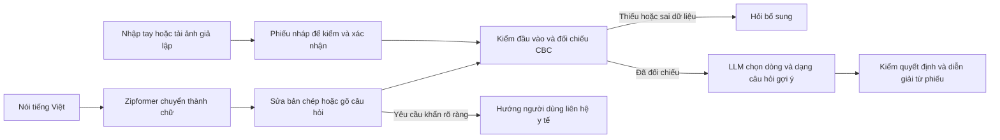

# AI SPEC — [Tên lát cắt] · Nhóm [tên nhóm] · Phòng [XXX] · Zone [X]

> Mốc nộp: §7 chốt chuẩn "đạt" tại **CP2 19:30 Thứ Sáu 27/11** · §0–§7 nộp **CP3 10:00 Thứ Bảy 28/11** · đủ §0–§10 **CP4 14:30 Thứ Bảy 28/11** · §10 changelog ghi tiếp đến **23:59 Thứ Bảy 28/11**.
> Đầu mỗi mục ghi bước guide (`02-guide.md` trong repo đề) chỉ cách điền. Mỗi mục ngắn, có số và nguồn; chi tiết để ở file được trỏ tới. Xoá dòng hướng dẫn trong ngoặc vuông khi điền xong.

Track: [ ] A · [ ] B · [ ] C · [ ] D · [ ] E — bài toán: [đề gợi ý trong file track, hoặc bài toán nhóm tự mở rộng] __
Data BTC cấp đã dùng (nếu có — không commit nguyên file): __

## §0. Hiện tại việc này diễn ra thế nào *(guide 1.1)*
- Luồng hiện tại của việc này, trong khoá hoặc trên app thật (3–5 bước; ảnh chụp từ tài khoản của mình, đã che thông tin):
- Công cụ / AI đang được dùng cho việc này (nếu có) + nguồn. Không kiểm được thì ghi "chưa kiểm":

## §1. Người dùng & bằng chứng *(guide 1.1, 1.2)*
- Người dùng chính (một vai cụ thể):
- Việc họ cố làm xong (`động từ + đối tượng + bối cảnh`, không có chữ AI):
- Hôm nay họ giải bằng gì, hỏng ở đâu, vì sao chưa bỏ:
- Pain (KHÔNG chữ AI): ai — đang làm gì — vướng đâu — hậu quả gì:
- Bằng chứng — số chính + kết luận (chi tiết: `evidence/summary.md`): __

## §2. Impact & quyết định chọn *(guide 1.3)*

| Hướng | Bao nhiêu người gặp | Bao nhiêu lần / tháng | Mỗi lần tốn gì | Impact / tháng | Làm kịp không | Chọn? |
|---|---|---|---|---|---|---|
|  |  |  |  |  |  |  |
|  |  |  |  |  |  |  |
|  |  |  |  |  |  |  |

- **Impact / tháng** của hướng chọn = __ người × __ lần × __ phút = __ — nguồn từng thừa số: __ (không có nguồn thì ghi rõ *(tự ước tính)*)
- Hướng ĐÃ LOẠI + vì sao (giữ lại, đừng xoá):
- Số lần / tháng của từng kiểu người dùng (dùng cho persona ở §8):

## §3. Giải pháp tương tự *(guide 2.1)*
- [sản phẩm / tính năng gần giống]: một điều đáng học · một điều đáng né · mình khác gì

## §4. Thiết kế *(guide 2.2, 3.2)*

Một thai phụ trưởng thành muốn hiểu dấu cao hoặc thấp trên phiếu CBC, AI chọn dòng liên quan để giải thích dựa trên dữ liệu đã xác nhận và gợi ý một câu hỏi cho buổi khám.

**Phạm vi** gồm đủ 21 chỉ số CBC và 3 chỉ số đông máu PT, APTT, FIB có trong bộ dữ liệu. Danh mục nằm ở `codebase/catalog.py`. Nhập tay hoặc đọc ảnh JPG/PNG vào các ô, người dùng kiểm tra và xác nhận, rồi hệ thống đối chiếu toàn bộ phiếu và trả bảng kết quả. Các yêu cầu chẩn đoán, điều trị hoặc kê thuốc được chuyển về nhân viên y tế. Khoảng tham chiếu lấy từ phiếu đã xác nhận, còn dữ liệu nghiên cứu dùng làm tài liệu tham khảo.

**Hình dạng.** Workflow cố định. Quy tắc đối chiếu và định dạng kết quả có các bước xác định, do đó một lời gọi model để chọn cách trả lời là đủ.

| Công cụ | Input | Output | Tác động ra ngoài |
|---|---|---|---|
| `compare_cbc` | Phiếu CBC đã xác nhận | Trạng thái từng dòng, hoặc trường cần sửa | Chỉ đọc |
| `transcribe_wav` | WAV PCM mono 16-bit | Câu hỏi dạng văn bản có thể sửa | Xử lý cục bộ |

**Mức tự động.** AI gợi ý, người dùng quyết định dùng thông tin nào để trao đổi với bác sĩ. Giao diện cho sửa số, đơn vị, khoảng và bản chép trước khi gửi.

**Chặn rủi ro.** Quy tắc yêu cầu đúng ngữ cảnh thai kỳ, định dạng số và đơn vị. Khi model chọn một dòng, hệ thống kiểm dòng đó có trên phiếu và chỉ hiển thị số đã đối chiếu. Yêu cầu khẩn rõ ràng được xử lý trước bước kiểm phiếu.

| Nguyên tắc | Chỗ áp dụng |
|---|---|
| G9 · Sửa dễ dàng | Sửa dữ liệu đọc từ ảnh và bản chép lời nói trước khi gửi |
| G10 · Thu hẹp phạm vi khi nghi ngờ | Hỏi lại khi thiếu dữ liệu, sai đơn vị hoặc model trả lựa chọn không hợp lệ |
| G11 · Giải thích vì sao | Hiển thị giá trị đối chiếu và hai giới hạn lấy từ phiếu |

**CP2.** Phiếu mẫu là giả lập. CLI có chế độ AI giả ghi nhãn rõ và có đường gọi Ollama. Giao diện đọc ảnh và ghi âm thuộc phần tích hợp.

## §5. Chỗ khó — 4 lớp + ≥6 kịch bản + 2 tấn công *(guide 2.3)*

| Kịch bản | Lớp (1–4) | Hành vi mong muốn (nói gì, hiện gì, cho làm gì tiếp) | Câu thử |
|---|---|---|---|
|  |  |  |  |
| *(tấn công)* |  |  |  |
| *(tấn công)* |  |  |  |

(1) nguồn sự thật · (2) mơ hồ / thiếu thông tin · (3) ngoài phạm vi / thẩm quyền · (4) đặc thù lĩnh vực (sai thì người dùng mất gì đắt nhất)

## §6. Bốn đường đi của trải nghiệm
- Mọi thứ suôn sẻ: · Không chắc (lớp 2): · Không có căn cứ (lớp 1): · Người dùng sửa:
- Bị đòi ngoài phạm vi (lớp 3): · Trường hợp đặc thù lĩnh vực (lớp 4):

## §7. Đánh giá & chuẩn "đạt" *(guide 2.4, 4.1)*
- Data card: `data/DATA_CARD.md` · bộ câu thử: `eval/benchmark.csv` — __ câu (thuong __ · kho __ · tu_choi __) · metric: `eval/metric_spec.yaml` (__ metric)
- **Chuẩn "đạt"** (chốt **trước 19:30 Thứ Sáu 27/11**, giữ nguyên đến 23:59 Thứ Bảy 28/11): "Đạt khi ≥ __% câu qua, và __"
- Kết quả: lượt 1 __/__ (__%) · lượt 2 __/__ (__%) — run ID: __ / __ → chi tiết `eval/report.md`, hồ sơ `eval/README.md`

## §8. Chi phí khi dùng thật *(guide 4.2)*
- Persona + giá: `cost/personas.yaml` · lượt mô phỏng: `cost/simulate-__.csv` (__ phiên)
- Chi phí / task thành công: __ (model __) · __ (model __)
- Chi phí / tháng ở quy mô thật: thấp __ · cơ sở __ · cao __ → chi tiết `cost/cost-estimate.md`
- So với impact / người / tháng (§2): đáng làm không, vì sao:

## §9. Rủi ro & an toàn
- Dữ liệu: đã ẩn danh gì, không thu gì, không đưa gì vào model gói miễn phí:
- AI **không được** làm gì kể cả khi người dùng yêu cầu:
- Ai có thể bị hại nếu AI sai, và nhóm chặn thế nào:

## §10. Phân công & changelog
- Phân công có tên (theo chặng, chia cặp — guide "Cách chia việc"): __
- Dùng AI vào việc gì (2–3 dòng; chi tiết `docs/ai-usage.md`):
- Nhật ký thay đổi — **mọi thay đổi sau CP2 19:30 Thứ Sáu 27/11 phải có dòng ở đây**:

**CP2 → CP4** (vd thu hẹp lát cắt, hỏi thêm người dùng, lần cải tiến trước lượt 2)

| Thời điểm | Đổi gì | Vì sao (trỏ về câu thử / lỗi / bằng chứng nào) |
|---|---|---|
|  |  |  |

**Sau CP4 (đến 23:59 Thứ Bảy 28/11)** (sửa theo góp ý — không sửa chuẩn "đạt", câu thử, số bằng chứng, kết quả các lượt đã chạy)

| Thời điểm | Đổi gì | Vì sao |
|---|---|---|
|  |  |  |
